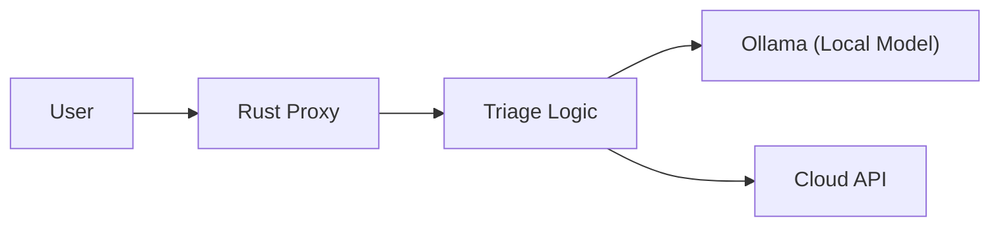

# Synapse-Edge: Technical Specification (2026)

## 1. Systemic Mission

**Synapse-Edge** addresses the 2026 'Inference Cost Crisis'—the unsustainable rise in cloud AI inference expenses—by introducing an *Autonomous Triage* system. This system dynamically routes user queries between Local-First (on-device, e.g., Ollama) and Cloud-based models, optimizing for cost, latency, and reliability. By prioritizing local inference when feasible and escalating to the cloud only when necessary, Synapse-Edge reduces operational costs and environmental impact while maintaining high service quality.

## 2. 2026 Directives

### Autonomous Reliability
- **Self-Healing Failover Loop**: The system continuously monitors inference health. If a local model fails or produces low-confidence results, requests are automatically rerouted to the cloud. The loop includes:
  - Health checks for local and cloud endpoints
  - Automated fallback and recovery
  - Learning from failures to improve future triage decisions

### GreenOps
- **Watts-per-Query**: Each inference request logs energy consumption (in watts) at both local and cloud endpoints. Metrics are aggregated for real-time and historical analysis.
- **Cents-saved-per-Request**: The system calculates the cost difference between local and cloud inference for every request, reporting cumulative savings.

## 3. Architecture Diagram

## 4. Implementation Roadmap

### Phase 1: Heuristic Proxy (Current)
- **Easy-prompt triage**: a prompt is routed to the local model when it is short
  (≤ 30 words), part of a short conversation (≤ 2 messages), and contains none of a
  curated list of "hard-signal" keywords (`explain`, `write code`, `debug`,
  `step by step`, `analyze`, `prove`, `refactor`, `in detail`). Anything else escalates
  to the cloud. Implemented in `triage()` in `src/main.rs`.
- Basic health checks and failover (autonomous cloud failover when the local node is unreachable)
- Initial metrics collection (energy, cost)

### Phase 2: Multi-Agent Consensus & Semantic Routing
- Multiple agents evaluate each request for optimal routing
- Semantic analysis to predict best execution venue
- Consensus mechanism for reliability and explainability
- Advanced observability and feedback loops

## 5. Observability

- **Decision Provenance**: Every routing decision logs a human-readable rationale (e.g.,
  `"easy: 12 words, no complex keywords"` or `"complex: detected keyword \"debug\""`),
  carried in the `TriageDecision.reason` field, plus failover triggers.
- **Persistent Logs**: All logs are written both to the terminal and to
  `logs/synapse-edge.log.YYYY-MM-DD` (rotated daily, gitignored), so routing
  history can be reviewed after the process exits.
- **Explainability API**: Exposes a trace of decision factors for each request, enabling audits and continuous improvement.
- **Outcome Tracking**: Not only logs if a request succeeded, but *why* a particular path was chosen, supporting root-cause analysis and transparency.

---

*This specification is designed for open-source collaboration and aligns with 2026 industry standards for sustainable, reliable, and explainable AI infrastructure.*
